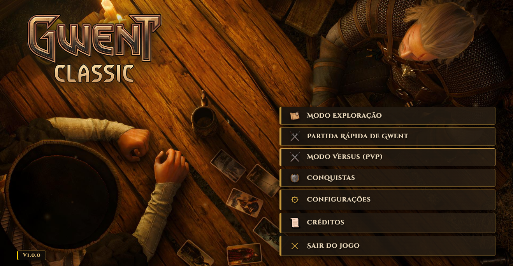
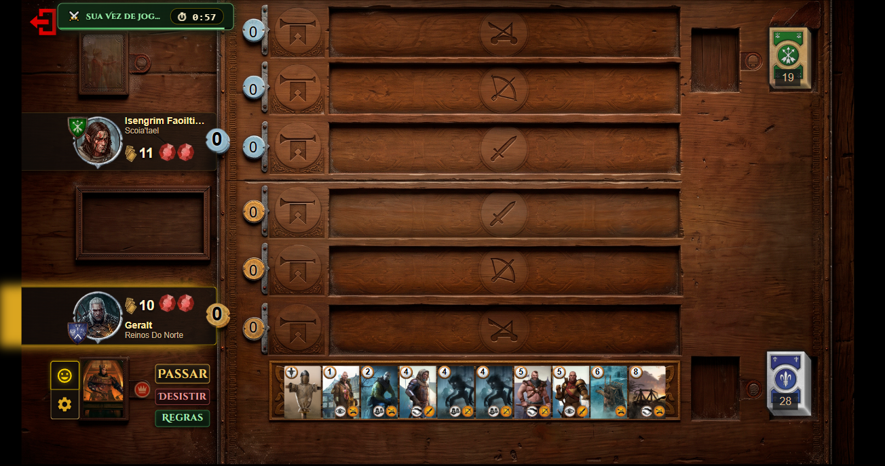
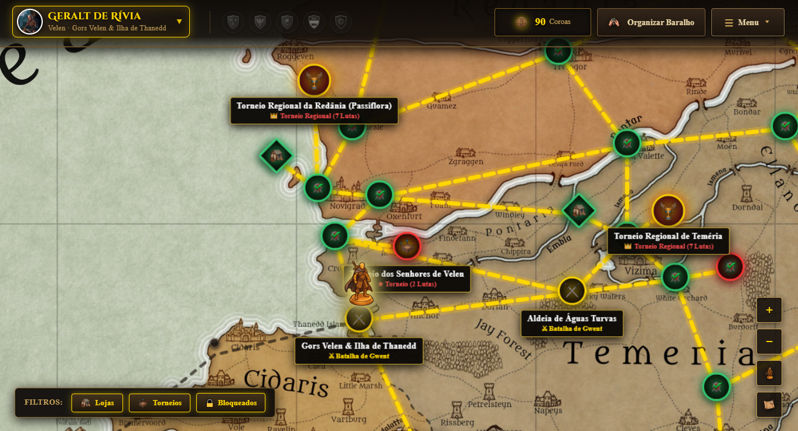
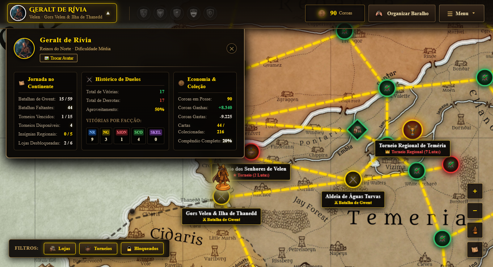
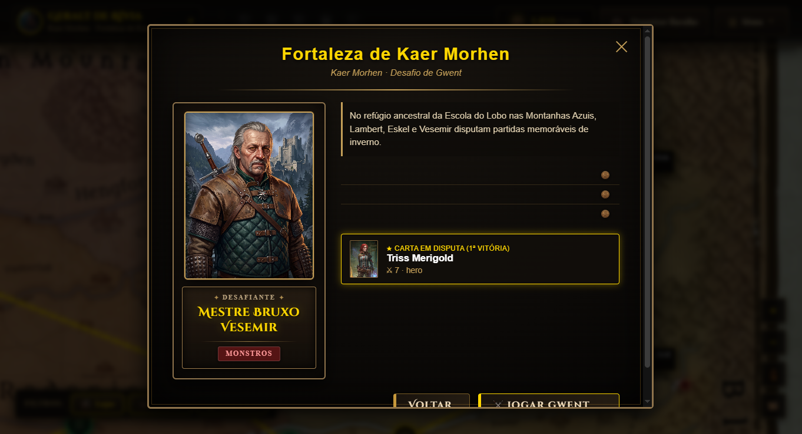
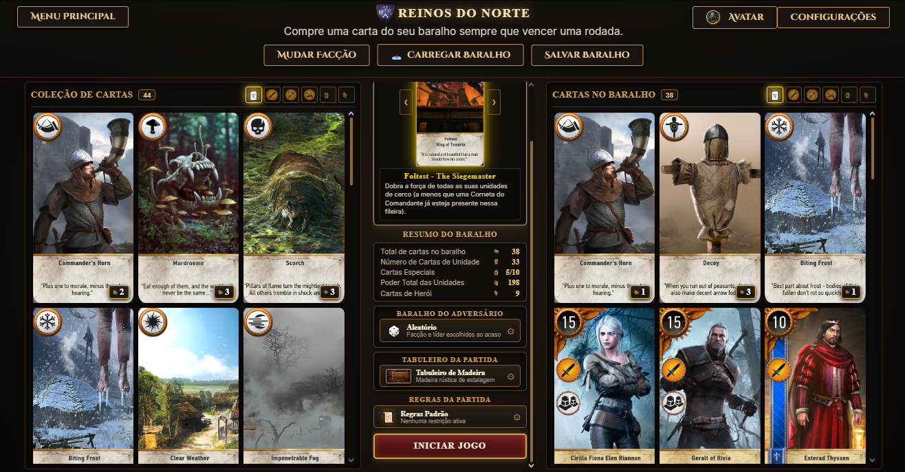
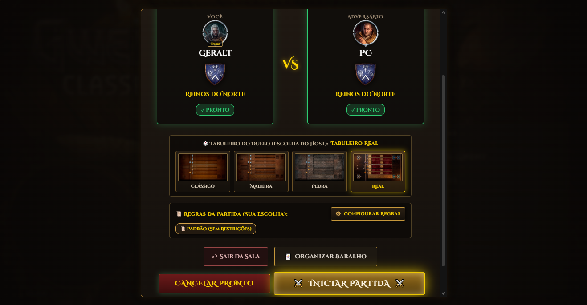
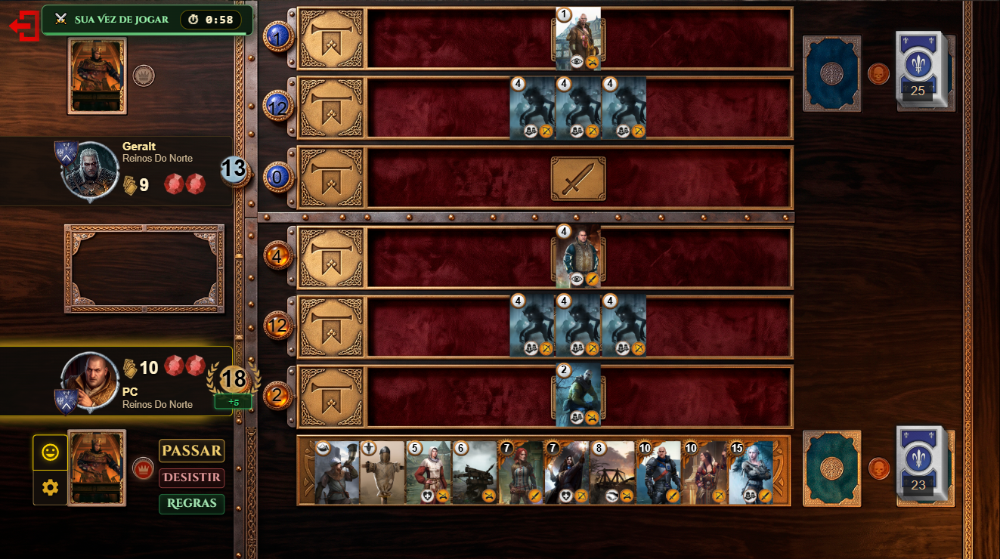
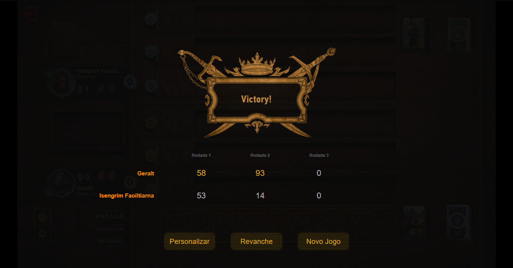

# ⚔️ Gwent Classic

<p align="center">
  <b>Languages / Idiomas:</b>
  <br>
  <b>🇺🇸 English (Current)</b> • <a href="README.pt-BR.md">🇧🇷 Leia em Português</a>
</p>

<p align="center">
  
</p>

<p align="center">
  <b>The definitive, authentic Gwent card game experience from The Witcher 3: Wild Hunt right on your PC, Android, or Web Browser!</b>
  <br>
  <i>Featuring Continent Campaign (Exploration Mode), Quick Match vs Tactical AI with Fast-Forward, Online P2P Multiplayer (Versus Mode), Achievements, Full Gamepad Support, and Standalone Native Launcher.</i>
</p>

<p align="center">
  
  
  
  <a href="https://ko-fi.com/d3studios" target="_blank"></a>
  
  
  
  
</p>

---

## 📜 About the Project

**Gwent Classic** is an authentic, highly polished, and expanded recreation of the acclaimed card minigame from *The Witcher 3: Wild Hunt*. Designed from the ground up to deliver the true tavern atmosphere of the Continent, the project integrates a geographic single-player story campaign, tactical AI with customizable match speeds, real-time peer-to-peer multiplayer without dedicated servers, and full cross-platform support.

---

## 📸 Screenshot Gallery

| Main Menu | In-Game Board Duel |
| :---: | :---: |
|  |  |

| Exploration Mode (4K Continent Map) | Collection Statistics & Compendium |
| :---: | :---: |
|  |  |

| Character Encounters & Dialogue | Full Deck Builder |
| :---: | :---: |
|  |  |

| Versus Mode Lobby (Ready) | Online P2P Multiplayer Match |
| :---: | :---: |
|  |  |

<p align="center">
  
  <br>
  <i>Round Victory Screen & Final Score Summary</i>
</p>

---

## 🌟 Key Features in v1.0.0 Release

### 🗺️ 1. Exploration Mode (Continent Campaign)
* **Interactive 4K Continent Map:** Travel across canonical Witcher regions: *White Orchard, Velen, Novigrad, Skellige Islands, Kaer Morhen, and Toussaint*.
* **Lore-Accurate Duels:** Challenge legendary characters (Bloody Baron, Dijkstra, Soothsayer, Madame Sasha, Ermion, and many more).
* **Tavern Economy & Card Compendium:** Earn ores and gold, purchase and unlock rare cards, and inspect your regional card collection completion.
* **Thematic Dialogues:** Immersive storytelling before each confrontation.

<p align="center">
  
</p>

---

### 🤖 2. Quick Gwent Match (Duels vs Enhanced AI)
* **Tactical Decision-Making AI:** Sophisticated heuristic decision-making across 3 difficulty tiers (*Easy, Medium, and Hard*), smartly balancing spy cards, decoys, Scorch tactics, weather modifiers, and leader abilities.
* **⏩ Fast-Forward Match Pacing (1.0x to 2.0x):** Adjust AI delay pauses, card inspection times, and table flight transitions from the settings menu.
* **🔢 Live Score Difference Indicator:** Optional in-game toggle displaying dynamic point margins (green badge for lead, red for deficit, gold for tie).
* **4 Distinct Boards:** Switch anytime between *Classic*, *Wood*, *Stone*, and *Royal* board styles.
* **In-Game Rules Summary:** Dedicated button on the table summarizing all 5 faction perks.

<p align="center">
  
</p>

---

### ⚔️ 3. Versus Mode (Online P2P Multiplayer)
* **Direct WebRTC Connection (PeerJS):** Real-time point-to-point duels between friends across the globe — no central server hosting costs.
* **5-Digit Room Codes:** Host or join private lobbies in seconds.
* **Competitive Match Clocks:**
  * ⏱️ **30-Second Initial Mulligan:** Swap up to 2 starting hand cards.
  * ⏱️ **1-Minute Turn Timer:** Smooth circular HUD countdown.
  * 🤖 **Anti-AFK Protection:** Intelligent auto-play triggers automatically if time expires, preventing soft-locks.
* **Authoritative Turn Synchronization (`TURN_SYNC`):** Guaranteed parity between host and guest.
* **Tavern Emotes & Reactions:** Expressive reactions with pulsing golden aura and in-game Witcher speech bubbles.

<p align="center">
  
</p>

---

### 🃏 4. Complete Deck Builder
* **All 5 Playable Factions:** *Northern Realms*, *Nilfgaard*, *Monsters*, *Scoia'tael*, and *Skellige*.
* **Full Expansions Included:** Cards from *Hearts of Stone*, *Blood and Wine*, and the *Next-Gen Roach* card.
* **Deck Import & Export:** Save, copy, and share customized deck JSON strings effortlessly.

<p align="center">
  
</p>

---

### 🎮 5. Full Gamepad Support
* Seamless native navigation mapped for **Xbox**, **PlayStation**, and generic gamepads (DirectInput/XInput) across all menus, the interactive map, and in-game duels.

---

### 🎭 6. Player Avatar Customization
* Choose your favorite tavern identity from dozens of iconic portraits (Geralt, Yennefer, Ciri, Triss, Regis, Dandelion, Olgierd, etc.).

---

### 🌐 7. Full Internationalization (i18n)
* Fully translated with instant runtime switching: **English**, **Português (Brasil)**, **Español**, and **Polski**.

---

## 📦 How to Play & Downloads

Grab the direct binaries from the [Official GitHub Releases Page](https://github.com/danielbernardoD3/gwent-classic/releases/latest):

### 💻 Windows PC (Portable Package)
1. Download **`GwentClassic-PC.zip`** from the latest release.
2. Extract into any folder.
3. Double-click **`GwentClassic.exe`**.
4. Press `F11` anytime to toggle **Borderless Fullscreen**.

### 📱 Android
1. Download **`GwentClassic.apk`** directly to your Android device.
2. Allow installation from unknown sources and install.
3. Enjoy native touch-optimized Gwent on the go with local offline save persistence.

### 🌐 In-Browser (GitHub Pages)
* Play instantly in your web browser with zero installation:  
  👉 **[https://danielbernardoD3.github.io/gwent-classic/](https://danielbernardoD3.github.io/gwent-classic/)**
* Or run a local HTTP server from your terminal:
  ```bash
  npx serve -l 8080 .
  ```
  Open `http://localhost:8080` in your favorite browser.

---

## 📁 Repository Structure

```text
gwent-classic/
├── GwentClassic.exe               # Standalone Windows launcher (Microsoft WebView2)
├── index.html                     # Core markup and UI entry point
├── style.css                      # Board, card styles, and animations
├── menu.css                       # Main Menu interface
├── versus.css                     # Versus Mode HUD, timers, and utility controls
├── story.css                      # Exploration Mode Continent Map styling
├── debugger.css                   # In-game inspector and debug tool (F2)
├── avatars.css                    # Character avatar styles
├── gwent.js                       # Primary Gwent game engine rules & state
├── versus.js                      # WebRTC P2P multiplayer network referee
├── story.js                       # Exploration Mode campaign progression
├── story_data.js                  # Region nodes, NPC dialogues, and rewards
├── abilities.js                   # Card abilities, weather, and scoring effects
├── cards.js                       # Complete card catalog database
├── factions.js                    # Faction passives and leader powers
├── gamepad.js                     # Complete gamepad input controller
├── achievements.js                # In-game achievement tracking system
├── common.js                      # Global audio, utilities, and auto-updater
├── i18n.js                        # Localization engine (EN, PT-BR, ES, PL)
├── docs/screenshots/              # In-game showcase screenshots
├── img/                           # Card artwork, board textures, and avatars
├── music/                         # Original tavern background soundtrack
└── sfx/                           # Atmospheric Witcher sound effects
```

---

## ☕ Support the Project (D3 Studios)

**Gwent Classic** is a 100% free, open-source fan project created with genuine passion for The Witcher universe. If you enjoyed playing rounds of Gwent at the tavern, appreciated the technical craftsmanship, and wish to support ongoing maintenance and future indie game projects from **D3 Studios**, consider buying the innkeeper a coffee!

<p align="center">
  <a href="https://ko-fi.com/d3studios" target="_blank">
    
  </a>
</p>

### 💳 Ways to Support:
* ☕ **Ko-fi (International / Credit Card / PayPal):**  
  👉 **[https://ko-fi.com/d3studios](https://ko-fi.com/d3studios)**

* 🇧🇷 **Pix (Brazil):**  
  * **Pix Key (Email):** `d3studios.contato@gmail.com`
  * **Beneficiary:** D3 Studios

*All contributions are completely voluntary and help support development time, hardware testing, and future gaming projects. Thank you so much for your support!* 🐺⚔️

---

## 📜 License & Legal Disclaimer

* **The Witcher**, **Gwent**, and all associated characters, names, lore, artwork, card designs, and audio tracks are registered trademarks and intellectual property of **CD PROJEKT S.A.** (CD PROJEKT RED) and Andrzej Sapkowski.
* **Gwent Classic** is an independent, non-commercial fan creation developed purely for entertainment and educational purposes under CD PROJEKT RED's Fan Content Guidelines.
* Codebase licensed under the **MIT License** with the **Commons Clause Condition v1.0** (commercial sale of the software is strictly prohibited).
